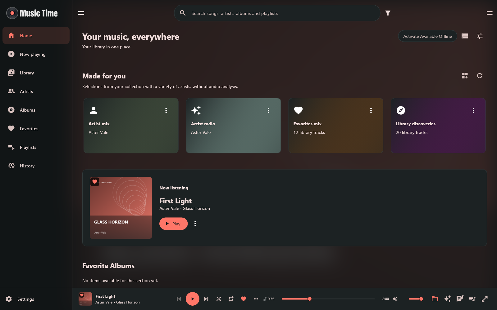
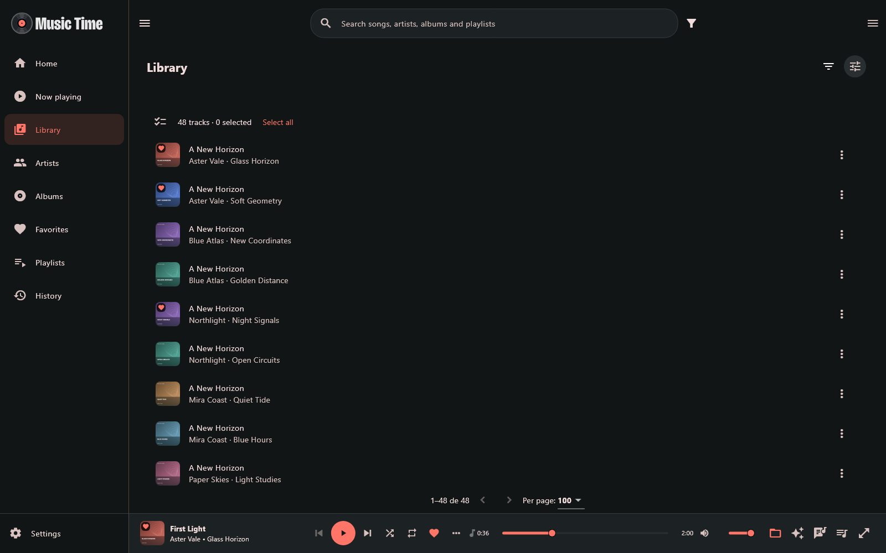
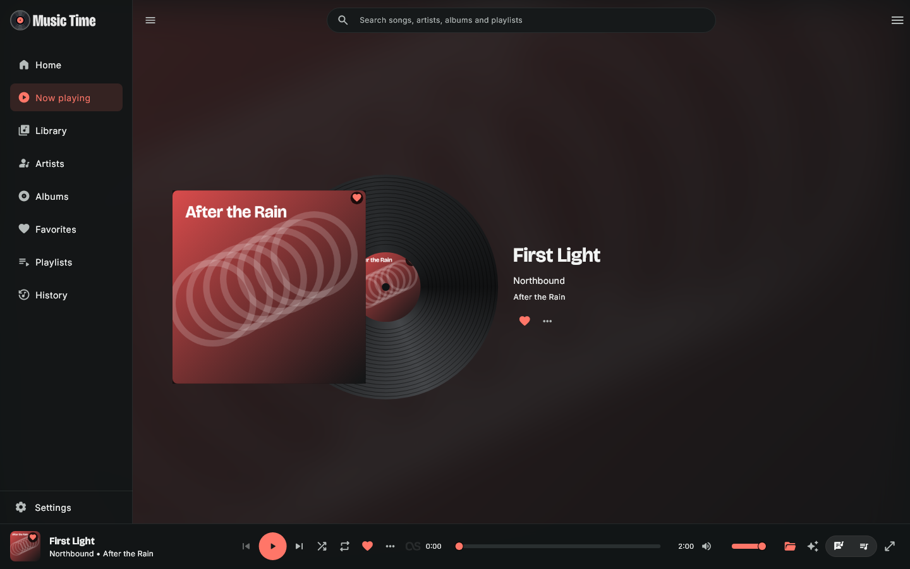
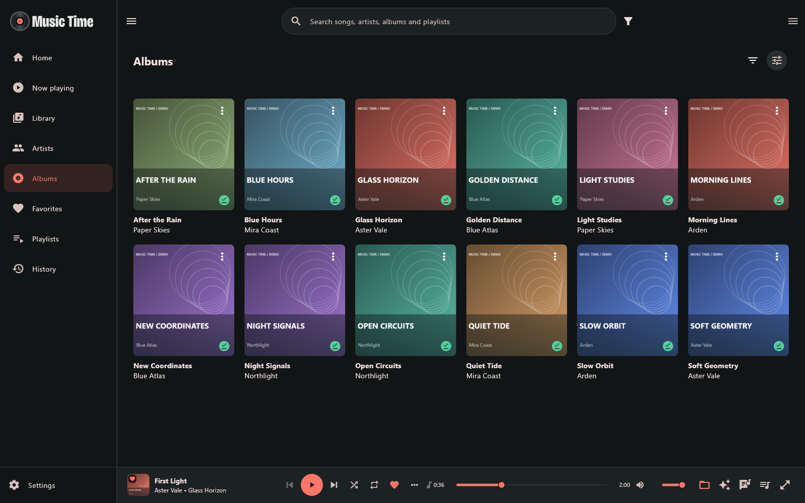
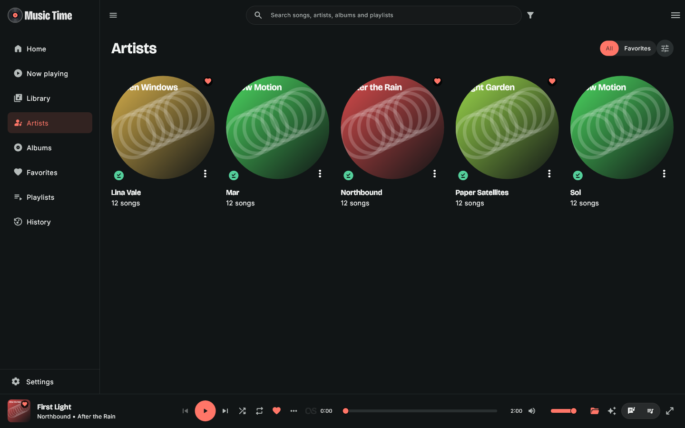
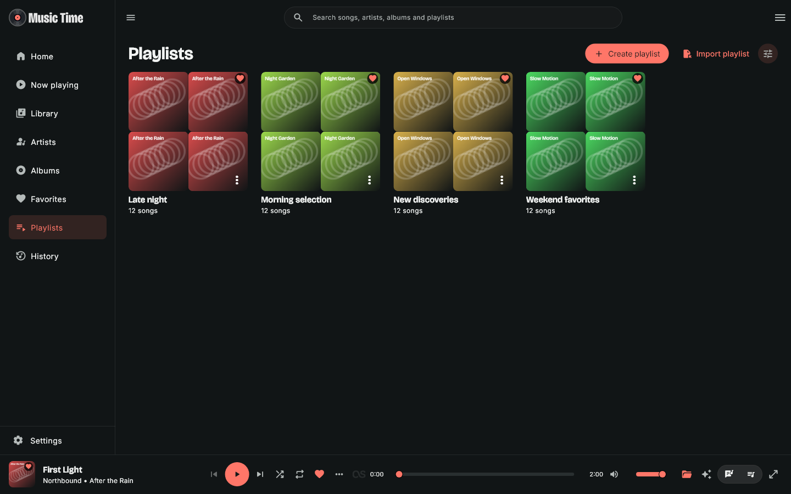
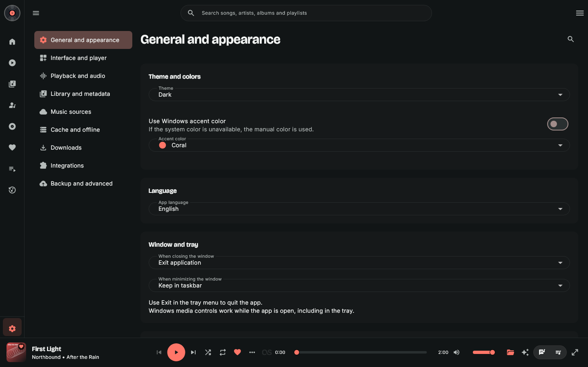
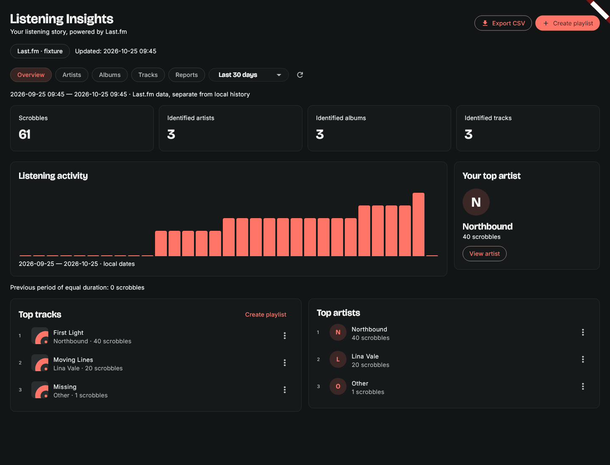

  

# Music Time

**Your music, your library, your time.** A personal Windows music player for local files, cloud libraries and media servers. Built with Flutter, Dart, MediaKit/libmpv and SQLite, without a Music Time backend.

[Download for Windows x64](https://github.com/eugilvando/Music-Time-Player/releases/latest) · [Português brasileiro](README.pt-BR.md) · [Provider setup](docs/provider-setup.md) · [Build from source](docs/building.md)

**Current release: 2.3.0+49.** This repository starts from the current application snapshot. It does not contain the development repository's history, personal catalog, playlists, credentials, backups or internal operational logs.

Design by **Gilvando Souza**.

## New in 2.3.0

Review album metadata in one operation and choose a cover for albums without artwork. Only checked fields are applied; individual track titles, credits and disc/track numbers are preserved. Manual covers survive synchronization and can be included in artwork backups. Thumbnail decoding and bounded artwork/portrait caches reduce image memory use. [Details, measurements and compatibility](docs/release-2.3.0.md).

## New in 2.2.1

Multi-disc albums now show ordered disc sections and play in disc/track order. MP3 TPOS and FLAC DISCNUMBER are read, including number/total values. Tracks in one folder or explicit CD1/CD2 subfolders are supported; existing track IDs, playlists and album favorites are preserved. [Details and upgrade compatibility](docs/release-2.2.1.md).

## What changed since 2.0

- **Listening Insights**, below History: exact/custom periods, personal Last.fm rankings, listening activity, previous-period comparison, weekly/monthly/yearly summaries and CSV export.
- Create a reviewed manual playlist from listening data or start a playback queue without saving; offline report cache and explicit partial-history coverage.
- Independent primary/secondary typography, refined Home controls and artwork indicators, Top Tracks on artist pages, and one action menu per playlist track.
- Resizable Queue/Lyrics side panels, window dimensions preserved on tray restore, and Classic, Vinyl, Minimalist, Cover Only and Lyrics Only player models.

## Install and start listening

1. Download `MusicTime-Setup-2.3.0.exe` from the [2.3.0 release](https://github.com/eugilvando/Music-Time-Player/releases/tag/v2.3.0).
2. Install for your Windows user. Flutter and Dart SDKs are **not** required to run the installed app.
3. Open **Settings → Music sources** and add local files or a music folder. Local playback does not require a cloud account.
4. To connect a cloud or server source, follow the [setup guide](docs/provider-setup.md), then synchronize its catalog.
5. Open Library, an album or a playlist and press Play. Use the item action button or right-click for more actions.

Windows x64 is the supported release target. The installer contains the application, playback engine, SQLite and required runtime libraries. It is not digitally signed: Windows may identify it as an unknown publisher. Check the release's SHA256 checksum before installation; do not change Windows security settings to install software you do not trust.

Closing the window normally keeps Music Time in the tray. Use **tray → Exit** to quit. If background work is active, the app offers an exit confirmation. Session restoration starts paused.

## Cloud access: bring your own application registration

**Google Drive and OneDrive require your own OAuth application Client ID.** This release does not include a shared developer registration, universal login credentials or someone else's authorized application ID. You can enter your registration in the app without rebuilding it.

| Source | What you need | Current scope |
| --- | --- | --- |
| Local files | Accessible files/folders | Catalog, tags, artwork and playback. |
| OneDrive | Microsoft application registration, public Client ID and personal Microsoft account | Personal OneDrive, multiple accounts/folders, browser authorization and read access. Work/school accounts are not advertised as supported. |
| Google Drive | Google Cloud project, Drive API enabled, Desktop OAuth Client ID, and client secret if Google requires it | My Drive or a visually selected folder, subfolders, browser authorization and read-only access. |
| WebDAV | Music-folder URL and server credentials | HTTPS by default; direct audio access. |
| Jellyfin / Emby | Server URL and user credentials | The user's accessible audio library; direct playback, without server transcoding. |
| SMB | Windows-accessible UNC share | Authentication through the Windows network session/Credential Manager. |

Google uses the **restricted** `drive.readonly` scope. Unverified/testing projects may show warnings or limit access to configured test users; testing refresh tokens can expire after seven days. An individual Client ID does not bypass Google or Microsoft policies, quotas, tenant restrictions or verification requirements. The selected folder limits what Music Time indexes; it does not narrow the provider's account-wide OAuth read permission. See [Google Drive and OneDrive configuration](docs/provider-setup.md) before connecting.

## Features in this version

### Home and navigation

- Home, Now Playing, Library, Artists, Albums, Favorites, Playlists, History and Listening Insights, with Settings in the sidebar footer.
- Collapsible sidebar, responsive layouts, persistent player and a raised side queue.
- Configurable Home sections: **Made for you, Now listening, Favorite Playlists, Favorite Tracks, Favorite Albums, Favorite Artists/Album artists, Discover Albums, Discover Artists, Recently Added Artists, Recently Added Albums, Most played artists and Last Played**.
- Per-section order, visibility, quantity, layout and independent card size, with live preview while customizing.
- Grid, list, carousel and horizontal compact-card styles; five card sizes: Extra Small, Small, Medium, Large and Extra Large.
- Now listening opens the full player. Source visibility and available-offline filtering are accessible from Home.
- English by default and Brazilian Portuguese. Music metadata and user-defined names keep their original spelling; some dynamic labels and diagnostics can still retain their original language.

### Library, search and organization

- Songs, albums, artists, album artists, genres, years, decades and folders in a unified local catalog.
- Context-aware search: global results on Home/Now Playing/History/Listening Insights, section search elsewhere; case/accent-tolerant matching, Escape and a clear button.
- Combined source/account/folder/artist/album/genre/year/favorite/offline/format/listening filters where relevant, plus quick All/Favorites controls.
- Sorting, detailed columns, compact lists, grids and compact horizontal cards. Library starts with Songs sorted by title.
- Ctrl/Shift selection and batch play, queue, favorites, playlist and offline actions.
- Independent favorites for tracks, albums, artists and playlists; accent-colored overlays and a visible currently-playing indicator.
- Artist pages with chronological discography, direct album playback, track view and album navigation. Album pages show known year/genre, track/disc numbers and more albums by the artist.
- Similar artists limited to those present in your library; optional artist biographies/portraits and custom artwork.
- Multiple artist credits, including `;`, comma, colon, `&`, `feat.` and `ft.`; `/` remains part of names such as AC/DC.
- Manual catalog metadata edits, artist/album merging, conservative grouping, hidden sources and restoration of source tags. These actions do not rewrite or rename your original music files.
- Shared artwork storage deduplicated by SHA256, on-demand cover loading, paginated main song lists, background catalog preparation and reuse during navigation.

### Playback, queue, mixes and lyrics

- Play/pause, previous/next, seek, volume and click-to-mute, shuffle cycles and repeat off/queue/track.
- Persistent queue/index/position/volume/shuffle/repeat, duplicate queue occurrences, drag reordering, play next, append, remove and clear.
- Queue heading shows the playing playlist or mix when available.
- Five Now Playing designs: Classic, Vinyl, Minimalist, Cover Only and Lyrics Only, adjustable artwork and optional blurred backgrounds.
- Player-bar organizer with ordering/visibility of individual controls and three movable optional separators; metadata fields, time/progress and offline/cache/permanent status.
- Optional continuous play adds related tracks **from your library** at the end of the queue, respecting visibility and offline rules.
- Track/album-related mixes, artist-only mixes and artist radio using available similar artists. Artist mix and radio have independent sizes, **40 tracks by default, configurable from 1 to 500**, preview and regeneration.
- Mixes create and start a **playback queue**. Saving a manual playlist is a separate explicit action.
- Five-band equalizer with presets, persistent bands and gain compensation.
- Local LRC/TXT sidecars, supported embedded MP3 lyrics, OneDrive lyric retrieval and optional free LRCLIB fallback. Synchronized scrolling, seek, per-track offset and presentation controls; word timing only when real timestamps exist.

### Playlists and listening history

- Create, rename, delete, favorite and reorder manual playlists; preserve repeated tracks and add/remove occurrences.
- Custom playlist artwork or a default collage of the first four available covers, without nested favorite indicators.
- UTF-8 M3U8 import/export, including local and OneDrive/Symfonium-style references.
- Multiple-file import continues after a file fails and presents a summary. Missing/ambiguous occurrences remain recorded for review instead of silently disappearing.
- Retry exact resolution, find a library track, inspect the original reference or remove the occurrence. The repair toolbar hides when all pending items have been resolved or removed.
- Export rebases relative references to the new file location. Transient signed download URLs are not used as permanent playlist identity.
- Local listening history with counts and last-played data. Importing Last.fm recent tracks does not fabricate local play counts.

### Sources, downloads and offline

- Add/reindex local files or folders and connect the sources listed above. Multiple personal OneDrive accounts/folders, source visibility, progress, cancellation and connection diagnostics.
- Explicit downloads for tracks, albums, artists, playlists and selections, with task state, pause/retry and individual permanent-download removal.
- Separate **permanent** and **cache** tabs, compact collapsible lists, size information and managed cleanup.
- Automatic audio cache: defaults of **10 GB**, preloading the next **5 tracks**, and **30 days** retention without use; configurable in Settings.
- Complete-file promotion, revision checks, shared references and protection of current/original/permanent files during cache cleanup.
- Global offline mode only uses accessible local files, completed downloads and valid cache, with no new remote transfers. OneDrive placeholders do not count as offline audio.

### Last.fm, settings and Windows integration

- Optional Last.fm browser authorization, independent now-playing/scrobble controls and a persistent outbox.
- Public favorites/recent/top-track imports with catalog matching and review; artist similarity and library-constrained radio. API credentials and authorization are required where applicable.
- Listening Insights: personal rankings, exact/custom periods, activity and previous-period comparison, weekly/monthly/yearly summaries, CSV and a reviewed playlist/queue generator. Reports use a separate per-profile cache, with offline access and explicit partial coverage; they do not alter local history. See [the Insights guide](docs/listening-insights.md).
- Nine redesigned settings categories: General and appearance; Interface and player; Playback and audio; Library and metadata; Music sources; Cache and offline; Downloads; Integrations; Backup and advanced.
- Dark/light/system themes, manual accent or Windows accent, typography, motion, artwork/background and detailed player customization.
- Selective, compressed `.mtbackup` backups and import of only the data you choose, including playlist-only imports. Optional artwork, provider application IDs and password-encrypted credentials/sessions. Legacy JSON import, storage information, artwork optimization and guarded reset remain available. See [backup guide](docs/backup.md).
- Windows tray, close/minimize behavior and native media controls with title/artist/album/artwork, play/pause, next/previous and seek.

## Screenshots

These images render actual application widgets using a **fictional, isolated demonstration library**. The interface gallery was captured in 2.0; the Listening Insights screenshot is from 2.2. Album artwork and lyric text were created for the demo. They do not show personal accounts, a bundled music catalog or proof of a live cloud-service connection.

| Library | Now Playing and queue |
| --- | --- |
|  |  |

| Albums | Artists |
| --- | --- |
|  |  |

| Playlists | Settings |
| --- | --- |
|  |  |

## Current limits

- Windows x64 only in this release. Android, Linux/Ubuntu and macOS are not supplied or validated.
- No streaming subscription, catalog acquisition, bundled songs, DRM bypass or Music Time backend.
- Source synchronization is currently manual/full within the selected scope. Checkpoints are not a general automatic/incremental sync system. Google Drive includes a paginated visual folder picker.
- OneDrive personal playback/reopening has user evidence. Google Drive, WebDAV, Jellyfin, Emby, SMB, multiple-account edge cases and live Last.fm delivery still need broader real-account/device validation. Controlled tests do not imply service certification.
- Main track pages are SQL-paginated; all album/artist aggregations are not yet fully SQL-paginated. Large collections still require performance checks on the target machine.
- Remote MP3/FLAC tag reading is more complete than other containers. There is no exhaustive real-device matrix for MP3, FLAC, M4A, OGG, Opus and WAV; compatibility depends on the container, codec and bundled engine.
- Online lyrics, biographies, portraits and similarity depend on third-party availability/matching and may be missing or incorrect. No guaranteed lyric coverage or homonym identification.
- Listening Insights reads up to 250 pages per operation, with continuation and partial coverage labels. Live-account acceptance remains pending. Generated playlists are manual snapshots; PDF reports and automatic playlist updates are not included.
- No smart-playlist AND/OR rule engine, playlist tags, named queue manager or independent resume position per album/playlist.
- No automatic offline-playlist membership refresh, rule-driven downloads, byte-range download resumption or general configurable download directory/concurrency.
- No sleep timer, ReplayGain, gapless/crossfade controls, AutoEQ/headphone profiles or advanced output selection. No Windows startup option, fully configurable global hotkeys or full notification system.
- Backups are limited to 128 MiB after decompression; optional artwork is capped at 64 MiB before export. Music files, managed audio and separate custom-image files are not included. Credentials require encryption; provider sessions may still need reconnection. Older versions cannot read the new archive format.

## Validation and development

Version 2.3.0 validation is recorded in [release notes](docs/release-2.3.0.md) and [the release manifest](release/validation.json). Controlled tests and fictional screenshots are separate from real-account acceptance.

See [building](docs/building.md), [provider setup](docs/provider-setup.md), [privacy and data](docs/privacy-and-data.md), [release notes](docs/release-2.3.0.md) and [third-party notices](THIRD_PARTY_NOTICES.md).

## License

Music Time's own source code is released under the [MIT License](LICENSE). Flutter, MediaKit/libmpv, FFmpeg and other dependencies retain their own licenses; MIT does not replace those terms. Third-party notices accompany the release. Music and artwork you add remain the property of their respective rights holders.
