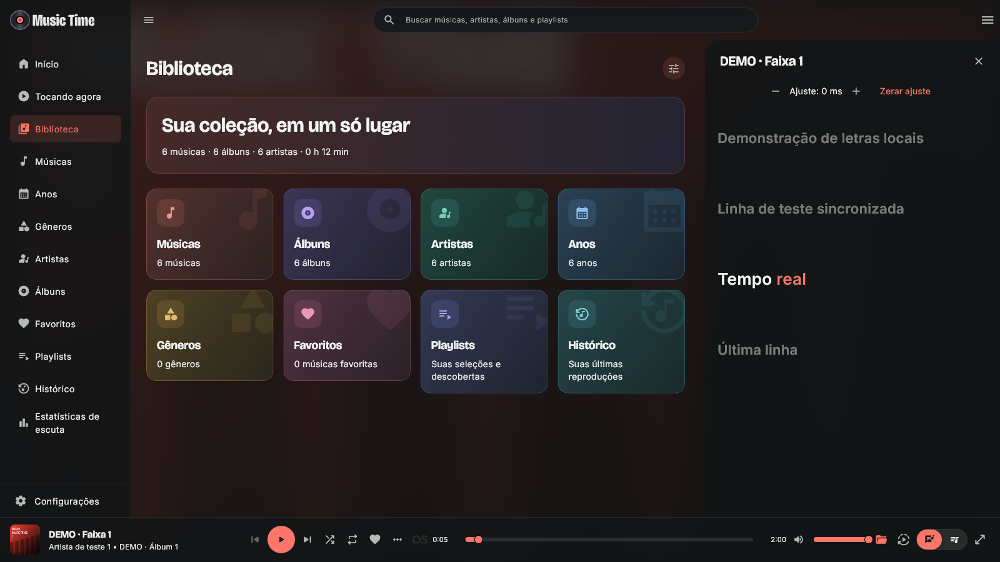
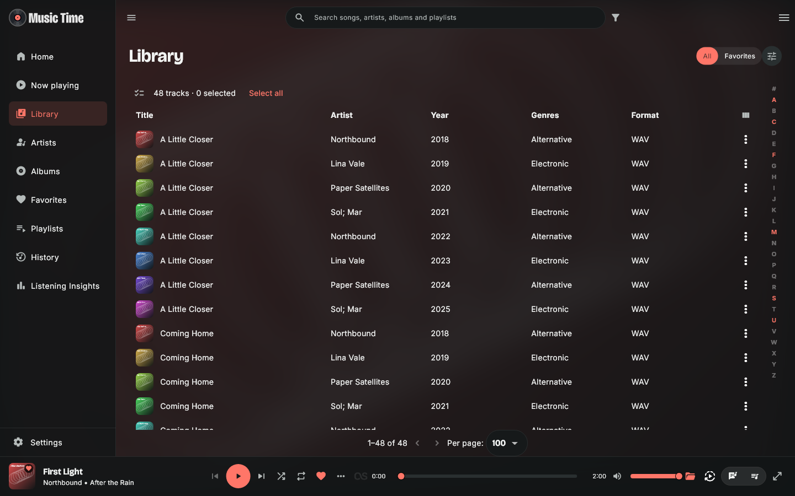
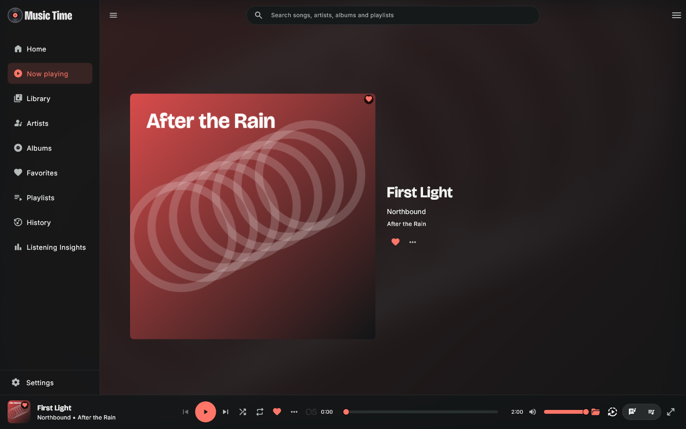
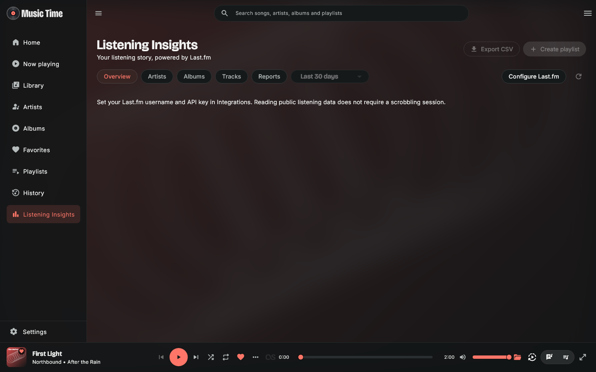
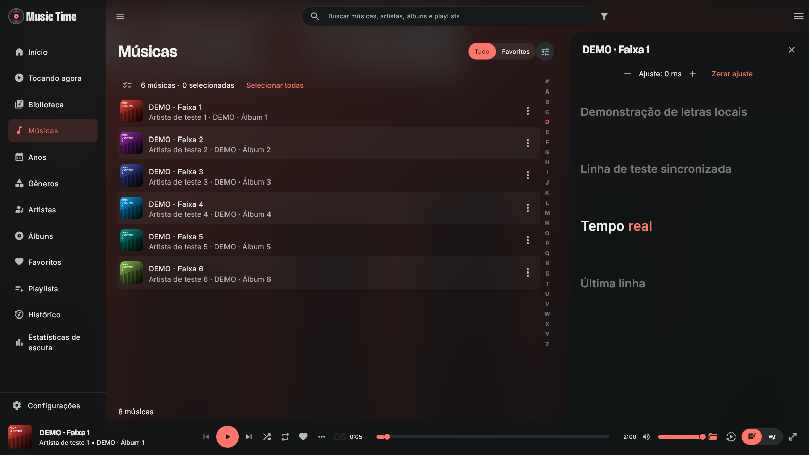

# Music Time

Escolha **Atual (Material Symbols Rounded), Solar ou Phosphor**, com estilo **Preenchido ou Contorno**, em Configurações → Geral e aparência → Ícones. A prévia é imediata, a escolha fica salva e os ícones funcionam offline.

**Sua música, sua biblioteca, seu tempo.** Player pessoal para Windows e Ubuntu, com arquivos locais, nuvens e servidores de mídia. Flutter/Dart, MediaKit/libmpv e SQLite, sem backend próprio.

[Baixar para Windows x64](https://github.com/eugilvando/Music-Time-Player/releases/latest) · [English / documentação completa das funcionalidades](README.md) · [Configurar fontes](docs/provider-setup.md)

**Código: 3.0.5+70. Instaladores publicados: 3.0.3+68.** Este repositório começa com uma cópia da versão atual. Não inclui o histórico do repositório de desenvolvimento, banco pessoal, credenciais, playlists pessoais, backups nem logs internos.

Design: **Gilvando Souza**.

**Ubuntu 24.04 x64:** [versão final 3.0.3](https://github.com/eugilvando/Music-Time-Player/releases/tag/v3.0.3-ubuntu). Validação de áudio, troca de saída e bandeja na VM/partição continua separada.

## Destaques atuais

**3.0.5 — Backup e capas:** corrigida a rejeição do Smart Flow. Backups com capas gravam as imagens usadas por partes, preservam a proteção por senha e mostram o andamento. Os formatos antigos continuam legíveis. O tamanho da capa responde também em Somente capa e na composição com letras. Backups novos com capas exigem 3.0.5 ou posterior para restaurar. [Detalhes e validação](docs/backup-and-artwork-3.0.5.md).

**Letras na 3.0.4:** prioridade para letras locais e embutidas, preparação da faixa atual e das duas próximas, cache entre consultas e sessões, fallback LRCLIB → lyrics.ovh e botão para atualizar a letra. Validação Windows aprovada; esta atualização do código não inclui um novo pacote Ubuntu. [Detalhes e validação](docs/lyrics-3.0.4.md).

O início prioriza conteúdo leve e prepara somente as coleções necessárias. Favoritos reaproveita resultados durante a sessão. Playlists têm miniaturas arredondadas e separadas; gêneros e anos ganham capas coloridas geradas localmente.

O cabeçalho da Biblioteca agora inclui **Organizar biblioteca**: escolha entre cinco tamanhos de cards e ative ou oculte cada categoria, incluindo **Histórico**. A visibilidade dos cards é salva independentemente da sidebar. Cards coloridos e resumo em degradê se adaptam aos temas claro/escuro e a janelas menores.

A **3.0.3** transforma a Biblioteca em uma central com resumo da coleção e atalhos. Músicas ganha um destino próprio com rolagem contínua; listas recebem linhas alternadas e os contornos Solar/Phosphor ficam mais espessos. As páginas reutilizam conteúdo em cache durante atualizações em segundo plano. No Linux, a sessão MPRIS oferece controles de mídia mesmo com a janela oculta. Fila inteligente, Smart Flow, crossfade automático, AutoEQ e perfis de EQ por saída continuam disponíveis.

[Notas Windows](docs/release-3.0.3.md) · [Áudio: uso e limites](docs/release-2.7.0.md) · [Instalação Ubuntu](docs/ubuntu-preview.md)

Use os links de Windows e Ubuntu acima para obter os pacotes atuais. Tags do código e notas históricas permanecem no Git; instaladores antigos podem ser removidos nas limpezas.

## Instalação

1. Baixe `MusicTime-Setup-3.0.3.exe` na [release Windows 3.0.3](https://github.com/eugilvando/Music-Time-Player/releases/tag/v3.0.3).
2. Instale no seu usuário do Windows. Não é necessário instalar Flutter/Dart para usar o player.
3. Em **Settings → Music sources**, adicione arquivos/pastas locais ou configure uma fonte. A reprodução local não exige uma conta.
4. Sincronize o catálogo e reproduza músicas, álbuns ou playlists.
5. O idioma inicial é inglês. Para português, selecione **General and appearance → Language** nas configurações. Alguns textos dinâmicos e diagnósticos ainda podem manter o idioma original.

O instalador Windows x64 inclui aplicação, motor de áudio, SQLite e bibliotecas necessárias. Não possui assinatura digital: o Windows pode identificar um editor desconhecido. Confira o SHA256 da release e não altere configurações de segurança para instalar algo em que não confia.

Fechar a janela normalmente mantém o app na bandeja. Use **bandeja → Sair** para encerrar; tarefas em segundo plano podem gerar um aviso. A sessão é restaurada pausada.

## Importante: Google Drive e OneDrive

**Cada usuário precisa registrar o próprio aplicativo OAuth e informar seu Client ID.** Esta distribuição não fornece um registro compartilhado nem usa códigos de outros aplicativos. É possível configurar pelo próprio Music Time, sem recompilar.

- **OneDrive pessoal:** crie um registro Microsoft para contas pessoais, cliente público, permissão delegada `Files.Read` e retorno `http://localhost:42813/oauth`. Copie o **Application (client) ID**, não o Object ID ou tenant ID. Não há Client Secret no fluxo Microsoft. Contas corporativas/escolares não são anunciadas como suportadas.
- **Google Drive:** crie um projeto Google Cloud, ative a Drive API, configure o consentimento e gere um **OAuth Client ID do tipo Desktop app**. Informe também o segredo desktop se o Google exigir. Em modo de teste, autorize sua conta como usuário de teste.
- O Google usa `drive.readonly`, um escopo restrito. Pode exigir verificação, limitar usuários e exibir avisos. Tokens de renovação de projetos externos em Testing podem expirar em sete dias. Criar um Client ID não contorna políticas, restrições administrativas ou cotas.
- A pasta selecionada limita a indexação do Music Time, mas não reduz a permissão OAuth do provedor a essa pasta.

O [guia de configuração](docs/provider-setup.md) traz as etapas e links oficiais. Senhas Microsoft/Google são informadas somente nos sites dos provedores. Não publique JSON de credenciais, tokens ou Client Secrets em issues.

## Fontes

| Fonte | Requisitos |
| --- | --- |
| Arquivos locais | Arquivos/pastas acessíveis no Windows. |
| OneDrive pessoal | Registro OAuth próprio, conta pessoal, navegador e seleção de pastas; várias contas/pastas implementadas. |
| Google Drive | Registro OAuth desktop próprio; My Drive ou pasta escolhida no seletor visual, com subpastas. |
| WebDAV | URL HTTPS completa da pasta musical e credenciais do servidor. |
| Jellyfin / Emby | URL, usuário e senha; áudio direto, sem negociação de transcodificação. |
| SMB | Caminho UNC acessível na sessão de rede do Windows; autenticação pelo Windows. |

## Funcionalidades da versão atual

- **Home:** 12 seções configuráveis — mixes, ouvindo agora, playlists/faixas/álbuns/artistas favoritos, descobrir álbuns/artistas, artistas/álbuns recentes, artistas mais ouvidos e últimas reproduções. Ordem, visibilidade, quantidade, estilo e tamanho independentes por seção, com prévia ao editar.
- **Organização da interface:** reordene/oculte itens da sidebar e barra, redimensione painéis de fila/letras e navegue por A–Z nas listas ordenadas por título.
- **Navegação e visualizações:** sidebar recolhível, fila lateral elevada, grades/listas/carrosséis, cards compactos horizontais, colunas detalhadas e cinco tamanhos de cards. Tema claro/escuro/sistema, acento manual ou do Windows, fontes, movimento e fundos personalizáveis.
- **Biblioteca e pesquisa:** músicas, álbuns, artistas, artistas de álbum, gêneros, anos, décadas e pastas; busca geral ou contextual, tolerante a caixa/acentos, limpeza com Esc/X, filtros combináveis, ordenação e seleção Ctrl/Shift com ações em lote.
- **Favoritos:** índices independentes de faixas, álbuns, artistas e playlists, filtros rápidos e indicadores na cor de destaque. A mídia em reprodução fica identificada na biblioteca. Clique direito abre as ações do item.
- **Destaques do artista:** até 20 faixas com prioridade Last.fm e fallback local, arraste individual para a fila e botões apenas com ícones para reproduzir ou embaralhar a lista exibida.
- **Artistas e álbuns:** discografia por ano, play direto do álbum, navegação entre artista/álbum, ano e gêneros conhecidos, numeração por disco/faixa, mais álbuns do artista e similares presentes na coleção. Retratos/biografias opcionais e imagens personalizadas.
- **Metadados e capas:** leitura local e complementação remota pertinente, edição manual e mesclagem somente no catálogo, restauração das tags originais, múltiplos artistas e agrupamento conservador. `/` é preservado em nomes como AC/DC. Capas iguais compartilham armazenamento por SHA256.
- **Fila por arraste:** faixas e álbuns da biblioteca, discografia e Home podem ser arrastados para a fila; álbuns seguem a ordem de disco/faixa. Salve a fila como playlist, preservando ordem e repetições. Ao desligar o shuffle, a ordem original é restaurada.
- **Player:** controles completos, mudo pelo volume, shuffle, repeat, fila editável com repetições, estado/posição persistidos e restauração pausada. Cinco modelos de Now Playing, capa ampliada e fundos desfocados.
- **Barra de reprodução:** organizador de ordem e visibilidade de itens, três separadores opcionais, campos de informações, tempos/progresso e status local/cache/permanente.
- **Mixes e rádio:** mix somente do artista, inclusive ao partir de faixa/álbum, ordenado pelo ranking global Last.fm com fallback por reproduções locais. Rádio mantém a seleção por similaridade. Mix e rádio de artista têm tamanhos independentes, padrão 40 e intervalo 1–500, prévia e regeneração. Iniciam uma fila; salvar playlist é uma ação separada. Play contínuo oferece Fila inteligente e Smart Flow independentes. A continuação considera a fila inteira; o fluxo intercala sugestões. [Modos e funcionamento](docs/release-3.0.3.md).
- **Crossfade:** desativado, automático ou manual, com transição suave, Smart fades e Mix only. O automático escolhe até seis segundos conforme a duração das faixas e análise compatível. Álbuns em ordem sequencial preservam suas transições.
- **AutoEQ e perfis de saída:** importe `ParametricEQ.txt`, revise e salve perfis com filtros de pico, graves/agudos e pré-amplificação protetora. Associe um perfil a cada saída padrão do sistema; ao trocar de fone/caixas no Windows ou Ubuntu, o app aplica o perfil salvo. Saídas sem associação ficam sem EQ.
- **Áudio e letras:** equalizador de cinco bandas com presets/compensação de ganho; letras LRC/TXT ao lado, MP3 embutidas suportadas, recuperação OneDrive e fallback opcional LRCLIB. Rolagem, seek, offset e apresentação configuráveis; palavras sincronizadas apenas com timestamps reais.
- **Playlists:** criar, renomear, excluir, favoritar, reordenar e preservar repetições; capa própria ou colagem de quatro capas. Importação/exportação M3U8 UTF-8 e referências OneDrive/Symfonium. Importação em lote continua após falhas, mantém pendências e permite revisar/vincular/remover. A barra de correção some quando as pendências terminam.
- **Favoritar no Last.fm:** novos favoritos de faixas podem ser enviados à conta conectada, com opção de desativar e fila persistente de novas tentativas.
- **Histórico e Last.fm:** histórico local com contagens reais; Last.fm opcional com autorização, now playing/scrobbling, outbox, favoritos/recentes/rankings e similaridade. Importar recentes não inventa contagens locais.
- **Playlists por gênero e humor:** 19 humores e gêneros baseados em etiquetas comunitárias do Last.fm, cruzados com a biblioteca local. Revisão antes de salvar; não são músicas externas nem classificação do áudio por inteligência artificial.
- **Listening Insights:** estatísticas Last.fm por período e resumos semanais/mensais/anuais, CSV, cache offline e prévia de playlist com associação conservadora. Salvar playlist e tocar somente uma fila são ações distintas. Requer usuário e chave Last.fm em Integrações. [Guia](docs/listening-insights.md).
- **Downloads e offline:** tarefas por faixa/coleção/seleção, retry, remoção individual dos permanentes e referências compartilhadas. Abas de permanentes/cache, listas compactas recolhíveis e informações de espaço. Cache padrão 10 GB, cinco próximas faixas e 30 dias sem uso. Offline global usa apenas arquivos presentes e válidos; placeholders OneDrive não contam.
- **Configurações e dados:** categorias com busca e página Sobre, cards, resumo da coleção, cache/downloads separados e colunas selecionáveis. Backup `.mtbackup` seletivo, importação apenas de playlists, capas opcionais e fontes/IDs. Credenciais/sessões são opcionais e exigem criptografia por senha. Músicas/downloads físicos não entram no backup.
- **Windows:** bandeja, comportamento ao fechar/minimizar e controles de mídia nativos com capa, metadados, play/pause, navegação e seek.

Editar informações, mesclar entidades ou remover uma ocorrência de playlist **não altera ou apaga suas músicas originais**.

## Capturas

A galeria mostra o Music Time 2.9.0, usando componentes reais e uma biblioteca fictícia isolada, com capas e textos criados para demonstração. Não são contas conectadas nem músicas incluídas no download.

| Biblioteca | Tocando agora e fila |
| --- | --- |
|  |  |

Mais capturas estão no [README em inglês](README.md#screenshots).

## Limitações atuais

- Pacotes para Windows x64 e Ubuntu 24.04 x64. Ubuntu passou em 152 testes direcionados, instalação apt e abertura gráfica em dois modos; áudio, troca de saída e bandeja reais ainda precisam de aceite na VM/partição. Android e macOS não são entregues/validados.
- Google Drive, WebDAV, Jellyfin, Emby, SMB e envios Last.fm têm implementação/testes controlados, mas ainda precisam de aceites reais mais amplos. Testes não equivalem a certificação por serviço.
- Sincronização manual/completa; não há política geral automática/incremental. Google oferece um seletor visual de pastas. Não há transcodificação Jellyfin/Emby.
- Agrupamentos de artistas/álbuns ainda não são integralmente paginados em SQL. Coleções grandes exigem medição na máquina real.
- Não há matriz exaustiva de formatos/codecs/dispositivos. Leitura remota MP3/FLAC é mais completa que outros containers.
- Letras, retratos, biografias e similaridade dependem de terceiros e podem não encontrar o item ou confundir homônimos.
- Sem regras AND/OR de playlists inteligentes, etiquetas, várias filas nomeadas ou posição independente por álbum/playlist.
- Sem atualização automática da seleção offline de playlists, downloads por regras, retomada de bytes ou diretório/concorrência gerais configuráveis.
- AutoEQ importa arquivos de texto; não pesquisa nem baixa perfis do autoeq.app. Análise de crossfade limitada a WAV PCM16 local; demais formatos usam duração como fallback. Mix only exige análise compatível e EQ desligado.
- Sem timer, modo ReplayGain configurável, garantia gapless, seletor avançado de saída no app, início com Windows ou sistema completo de atalhos/notificações configuráveis.
- Backup limitado a 128 MiB descompactados, com capas opcionais até 64 MiB. Credenciais exigem senha; sessões podem expirar. Versões antigas não leem o novo arquivo `.mtbackup`.

Consulte [dados e privacidade](docs/privacy-and-data.md), [compilação](docs/building.md), [release](docs/release-3.0.3.md) e [avisos de terceiros](THIRD_PARTY_NOTICES.md). O código próprio do Music Time usa [MIT](LICENSE); as dependências mantêm suas licenças.

## Validação

Windows 3.0.3: consulte o [manifesto de validação](release/validation.json) para as regressões direcionadas, análise, compilação e instalação. A suíte completa não foi repetida nesta versão.

[Ubuntu 3.0.3 final](https://github.com/eugilvando/Music-Time-Player/releases/tag/v3.0.3-ubuntu) · [Instalação e limites](docs/ubuntu-preview.md).

## Music Time 3.0 — Biblioteca / Songs

