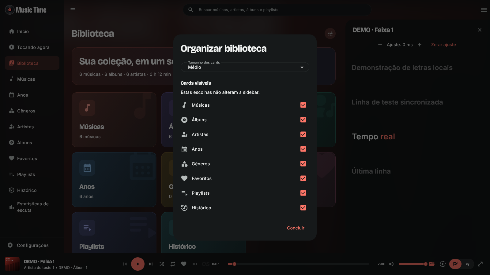

# Music Time 3.0.2

- Histórico integrado à Biblioteca, com acesso às reproduções recentes.
- Organizador no cabeçalho da Biblioteca reúne os cinco tamanhos de cards e a seleção dos atalhos visíveis.
- Visibilidade dos cards salva separadamente da sidebar: cada área pode ser personalizada sem alterar a outra.
- Removido o subtítulo “Explorar biblioteca”, deixando o resumo e os cards em destaque.

Atualização preserva biblioteca, histórico, contas e preferências existentes. Nenhum dado pessoal é incluído nas capturas ou na distribuição.

