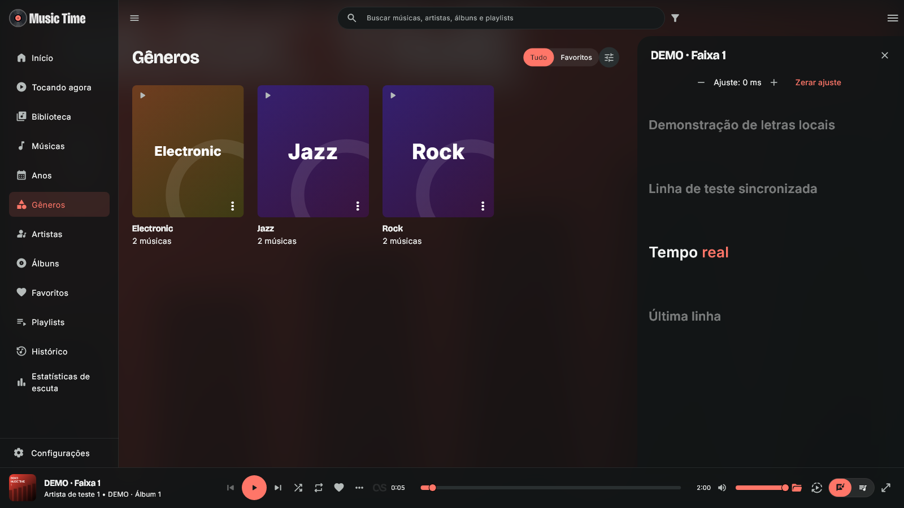
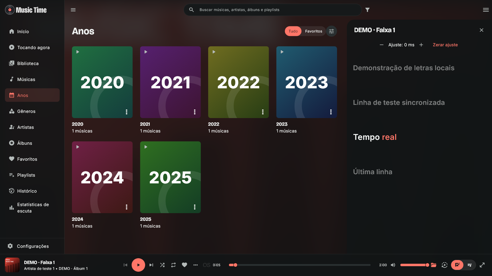
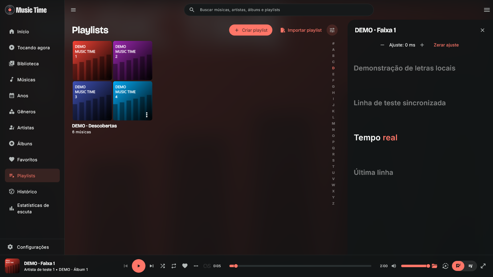

# Music Time 3.0.3

- Início mostra conteúdo leve antes da preparação dos mixes e coleções; seções ocultas deixam de exigir agrupamentos desnecessários. Sugestão de artista calculada uma única vez por preparação, com pontuações reutilizadas na ordenação.
- Favoritos preserva a visualização entre visitas durante a sessão. Navegar não força uma atualização completa; alterações reais e atualização manual continuam atualizando os dados. Favoritar uma faixa não relê fontes e downloads.
- Miniaturas internas das playlists com cantos arredondados e espaçamento entre imagens.
- Capas locais para gêneros, anos e décadas, com degradê, cores estáveis e nome ou número em destaque.

Dados, contas, filas e preferências existentes são preservados. Capturas de demonstração usam somente dados fictícios.

Validação Windows: análise completa e 49 testes direcionados aprovados em rodadas. A rapidez percebida na biblioteca real do usuário ainda precisa de conferência após a instalação.

